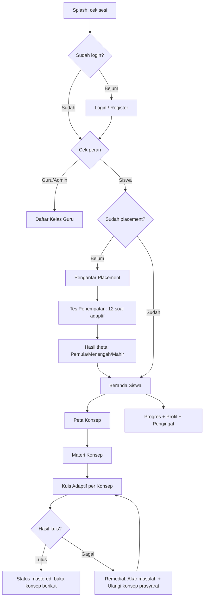
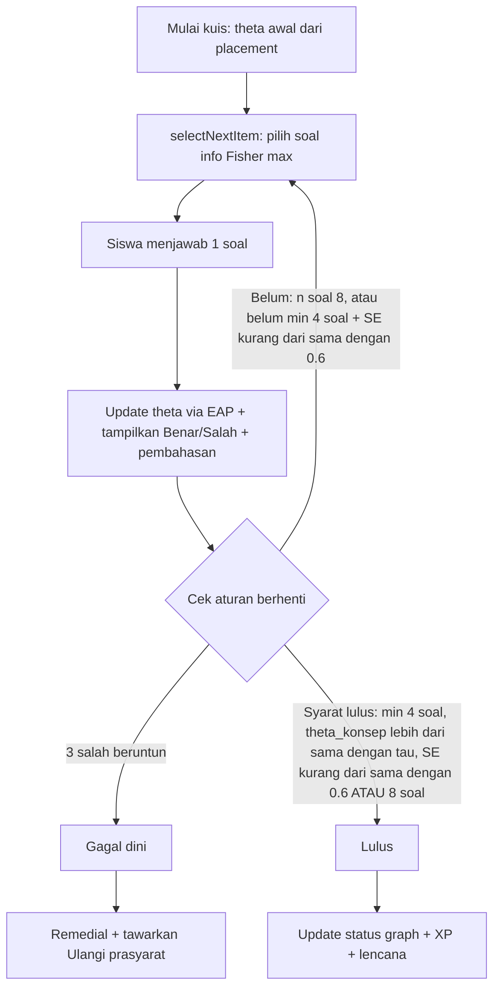

/# Laporan Tahap 2 & Tahap 3 — AdaptiLearn

> Aplikasi mobile pembelajaran adaptif Matematika dasar (SMP/SMA) berbasis
> Knowledge Graph + Item Response Theory 2PL.
> Stack: Flutter + Dart, Riverpod, go_router, supabase_flutter, fl_chart,
> flutter_local_notifications, shared_preferences.
> Bahasa UI: Bahasa Indonesia. Peran: `student`, `teacher`, `admin`.

Dokumen ini disusun untuk memenuhi luaran **Tahap 2 (Perancangan Sistem
dan Antarmuka)** dan **Tahap 3 (Implementasi Aplikasi dengan Flutter)**.
Isinya dirujuk langsung dari kode MVP yang ada (`lib/`, `supabase/`,
`docs/progress.md`, `docs/test-report.md`).

---   

## Bagian A — Tahap 2: Perancangan Sistem dan Antarmuka

### A.1. Diagram alur aplikasi

#### Alur 1 — Siswa baru sampai belajar adaptif



#### Alur 2 — Kuis adaptif per konsep (inti IRT 2PL)



Rumus inti (wajib dikutip di laporan):

* Peluang jawab benar: `P(theta) = 1 / (1 + exp(-a * (theta - b)))`
* Informasi Fisher: `I = a^2 * P * (1 - P)`
* Estimasi theta: EAP grid `-4..4` langkah `0.1`, prior `N(0,1)`
* Dikuasai bila: minimal 4 soal, `theta_konsep >= tau`, `SE <= 0.6` (atau 8 soal tercapai). Gagal dini bila 3 salah berturut-turut.
* Implementasi: `lib/domain/irt/`, `lib/domain/graph/`, tanpa import Flutter (logika murni + unit test).

### A.2. Kasus penggunaan (use case) / skenario pengguna

#### Diagram use case (teks — gambar di draw.io dari tabel ini)

* Aktor **Siswa**: UC-01 s.d. UC-05
* Aktor **Guru**: UC-06
* Aktor **Admin**: UC-07 (via dashboard Supabase, bukan di aplikasi — KF-15 ditunda)

| Kode | Aktor | Kasus penggunaan | Rujukan kode |
|------|-------|------------------|--------------|
| UC-01 | Siswa | Registrasi, masuk, keluar; validasi form Bahasa Indonesia | `features/auth/` KF-01 |
| UC-02 | Siswa | Tes penempatan adaptif 12 soal lintas konsep, hasil Pemula/Menengah/Mahir | `features/placement/` KF-02 |
| UC-03 | Siswa | Lihat peta konsep interaktif, baca materi, kerjakan kuis adaptif + pembahasan | `features/knowledge_map/`, `features/concept/`, `features/quiz/` KF-03 s.d. KF-07 |
| UC-04 | Siswa | Jalur remedial: kartu `Akar masalah: <konsep>` + `Ulangi <konsep>`, kembali ke konsep awal bila lulus | `features/quiz/` KF-08 |
| UC-05 | Siswa | Gamifikasi (XP/level/streak/lencana), pengingat harian, dasbor progres, gabung kelas via kode | `features/gamification/`, `features/progress/`, `features/student/` KF-09 s.d. KF-11, KF-13 s.d. KF-14 |
| UC-06 | Guru | Buat kelas (kode 6 karakter), lihat daftar siswa (theta, dikuasai, terakhir aktif), konsep sering gagal, detail siswa | `features/teacher/` KF-12 |
| UC-07 | Admin | Kelola bank soal (saat ini via seed SQL + dashboard Supabase) | `supabase/seed.sql` KF-15 (ditunda di aplikasi) |

#### Skenario 1 — Siswa gagal lalu remedial (jalur utama adaptif)

1. Siswa membuka konsep yang berstatus `open` dari Peta Konsep.
2. Siswa membaca materi lalu menekan Mulai Kuis.
3. Sistem memilih soal dengan informasi Fisher tertinggi (`selectNextItem`).
4. Setiap jawaban langsung menampilkan Benar/Salah + pembahasan.
5. Sistem menghitung ulang theta (EAP) setiap soal (< 2 detik).
6. Jika 3 salah beruntun → kuis dihentikan dini (gagal dini).
7. Hasil menampilkan kartu `Akar masalah: <konsep prasyarat>` + tombol `Ulangi <konsep>`.
8. Setelah lulus remedial, sistem menawarkan kembali ke konsep awal.

#### Skenario 2 — Guru memantau kelas

1. Guru membuat kelas → sistem membuat kode 6 karakter otomatis.
2. Siswa bergabung via kode di Profil (RPC `join_class`, validasi 6 alfanumerik).
3. Guru membuka detail kelas: daftar siswa (theta, jumlah dikuasai, terakhir aktif) + konsep paling sering gagal.
4. Guru membuka detail satu siswa untuk riwayat dan status per konsep.

Prinsip UX yang diterapkan: tombol minimal 48 dp, label + ikon + kontras chip status ≥ 4,5:1, tidak ada overflow pada lebar 360 dp, semua pesan galat Bahasa Indonesia.

### A.3. Struktur navigasi aplikasi

Sumber: `lib/core/router/app_router.dart` (`routerProvider`, `AppRoutes`).

```
Splash /splash
Login /login, Register /register          (publik)
Placement /placement → /placement/test → /placement/result
Siswa (StatefulShell 4 tab, wajib sudah placement):
  /student/home        Beranda (sapaan, XP/streak/level, lanjutan, target)
  /student/map         Peta konsep interaktif
  /student/progress    Dasbor progres
  /student/profile     Profil + gabung kelas + pengingat + lencana
  /student/material/:conceptId?from=   Materi + tombol Mulai Kuis
  /student/quiz/:conceptId?from=       Kuis adaptif + hasil + remedial
Guru/Admin:
  /teacher/classes                          Daftar + buat kelas
  /teacher/classes/:classId                 Detail kelas
  /teacher/classes/:classId/students/:studentId  Detail siswa
Dev: /dev/gallery
```

Aturan redirect peran (`redirect` di `routerProvider`):

* Belum login → `/splash` lalu `/login`.
* Guru/admin → selalu `/teacher/classes` bila membuka rute siswa.
* Siswa belum placement → dikunci ke `/placement` (hasil boleh dibuka sekali tepat setelah tes; `/placement/test` tidak bisa diulang bila sudah tuntas).

> Catatan: `lib/core/routes/app_router.dart` adalah berkas lama dan tidak
> dipakai. Router aktif hanya `lib/core/router/app_router.dart`.

### A.4. Rancangan basis data / model data

#### Basis data Supabase (14 tabel) — sumber `supabase/schema.sql`

| # | Tabel | Isi / kunci |
|---|-------|-------------|
| 1 | `profiles` | `id (FK auth.users)`, `full_name`, `role student/teacher/admin` |
| 2 | `classes` | `id`, `teacher_id`, `name`, `join_code` unik 6 karakter |
| 3 | `class_members` | `class_id, student_id` (PK komposit) |
| 4 | `concepts` | simpul graph: `code (K01–K08)`, `title`, `topic`, `tau`, `order_index` |
| 5 | `concept_edges` | relasi prasyarat: `prerequisite_id → concept_id` |
| 6 | `materials` | 1 materi per konsep: `concept_id` unik, `title`, `body_markdown` |
| 7 | `items` | bank soal + IRT 2PL: `concept_id`, `question`, `options (jsonb)`, `correct_index 0–3`, `explanation`, `a`, `b` |
| 8 | `quiz_sessions` | `student_id`, `concept_id`, `status berjalan/selesai/batal`, `final_theta` |
| 9 | `responses` | jawaban: `session_id`, `student_id`, `item_id`, `selected_index`, `is_correct`, `theta_after` |
| 10 | `student_ability` | theta global: `student_id (PK)`, `theta`, `se` |
| 11 | `student_concept_state` | status per konsep: `student_id, concept_id`, `status locked/open/learning/mastered`, `theta_c`, `n_answered` |
| 12 | `gamification` | `student_id (PK)`, `xp`, `level`, `streak`, `last_active_date` |
| 13 | `badges` | `code`, `name`, `description` (8 lencana seed) |
| 14 | `user_badges` | `user_id, badge_id`, `awarded_at` |

Keamanan: RLS aktif semua tabel (`supabase/rls.sql`), guru hanya membaca murid di kelasnya, siswa hanya data miliknya; gabung kelas via fungsi `join_class(kode)` (`SECURITY DEFINER`); trigger `handle_new_user` membuat `profiles + gamification + student_ability` otomatis; cegah eskalasi peran non-admin. Seed: 8 konsep, relasi prasyarat, materi, 64 soal (8/konsep), 8 lencana (`supabase/seed.sql`).

#### Model domain Dart — sumber `lib/domain/models/`

`Concept, ConceptEdge, ConceptStatus, Item, Question, QuizSession,
ResponseRecord, ResponseHistory, AbilityEstimate, StudentConceptState,
LearningMaterial, GamificationState, ClassInfo, UserProfile, UserRole,
PendingResponse`. Tanpa code generation, immutable, tanpa import Flutter.

Status konsep: `locked → open → learning → mastered` dihitung dari prasyarat + theta (`lib/domain/graph/`).

### A.5. Sketsa awal (wireframe)

Cukup 6 wireframe low-fidelity (kotak + garis) untuk: Login, Beranda Siswa, Peta Konsep, Materi, Kuis (kartu soal + 4 opsi + tombol Jawab), Hasil + Remedial. Prinsip: judul + 1 aksi utama per layar, tombol ≥ 48 dp, teks Bahasa Indonesia, konsisten AppBar–Card–Chip.

Temuan audit 360 dp yang sudah diperbaiki (bukti iterasi desain → implementasi, lihat `docs/test-report.md`): baris "Belum punya akun?/Daftar" jadi `Wrap`, tombol `Ulangi <konsep>` vertikal, grid lencana 132 → 152 dp.

### A.6. Purwarupa antarmuka

Purwarupa = aplikasi MVP itu sendiri (dapat dijalankan). Cara tunjukkan di laporan: pasang 6–8 screenshot emulator berdampingan dengan wireframe-nya (sebelum–sesudah). Berkas contoh yang sudah ada: `flutter_01.png`, `flutter_02.png`. Tambahkan screenshot: placement, peta (zoom/geser), kuis + pembahasan, hasil + remedial, progres (grafik theta), kelas guru.

### A.7. Rancangan halaman utama dan halaman pendukung

| Jenis | Layar | Berkas |
|-------|-------|--------|
| Utama | Beranda siswa | `features/student/presentation/student_home_screen.dart` |
| Utama | Peta konsep interaktif (InteractiveViewer + CustomPainter, ketuk node, legenda) | `features/student/presentation/student_map_screen.dart`, `features/knowledge_map/presentation/` |
| Utama | Kuis adaptif + hasil + remedial | `features/quiz/presentation/quiz_screen.dart`, `quiz_result_screen.dart` |
| Utama | Tes penempatan + hasil | `features/placement/presentation/placement_screen.dart`, `placement_test_screen.dart`, `placement_result_screen.dart` |
| Pendukung | Splash, Login, Register | `features/auth/presentation/` |
| Pendukung | Materi markdown + Mulai Kuis | `features/concept/presentation/concept_screen.dart` |
| Pendukung | Progres (grafik theta fl_chart, ringkasan, bar per konsep, riwayat + refresh) | `features/student/presentation/student_progress_screen.dart`, `features/progress/` |
| Pendukung | Profil (XP/level/streak/lencana, gabung kelas, jam pengingat) | `features/student/presentation/student_profile_screen.dart` |
| Pendukung | Kelas guru, detail kelas, detail siswa | `features/teacher/presentation/` |
| Pendukung | Galeri dev | `features/dev/presentation/gallery_screen.dart` |

---

## Bagian B — Tahap 3: Implementasi Aplikasi dengan Flutter

### B.1. Proyek Flutter yang dapat dijalankan

```bash
flutter pub get
flutter run   # tanpa backend tetap jalan (sebagian layar kosong)

# Dengan Supabase (disarankan):
flutter run \
  --dart-define=SUPABASE_URL=https://contoh.supabase.co \
  --dart-define=SUPABASE_ANON_KEY=isi-anon-key-di-sini
```

Setup backend (idempoten, urut): `supabase/schema.sql → supabase/rls.sql → supabase/seed.sql` di SQL Editor. Kunci asli tidak di-commit (`.env` di-gitignore, contoh di `.env.example`). Build rilis 13 Okt 2026: `flutter build apk --release` → `app-release.apk` 57,4 MB.

Arsitektur terstruktur (lihat `README.md` + `AGENTS.md`):

```
lib/app.dart, lib/main.dart
lib/core/        theme, router, widgets, validators, error
lib/domain/      LOGIKA MURNI (irt/, graph/, gamification/, models/, repositories/)
lib/data/        datasources/ + repositories/*_impl.dart (Supabase + SharedPreferences)
lib/features/<fitur>/application/ + presentation/
```

Aturan dipatuhi: null-safety, tanpa code generation, tanpa logika bisnis di widget, IRT/graf ber-unit-test, commit Conventional Commits.

### B.2. Implementasi antarmuka aplikasi

Komponen bersama (`lib/core/widgets/` + `lib/core/theme/app_theme.dart`): `AppButton, AppCard, AppTextField, ConceptStatusChip, XpBadge, LevelBadge, LoadingView, ErrorView, EmptyView, BackendWarning`. Layar per fitur di `lib/features/*/presentation/` (daftar di A.7). Contoh perilaku: tombol Jawab nonaktif sebelum memilih opsi; feedback Benar/Salah + pembahasan tiap soal; animasi naik level; legenda peta; grafik garis theta (fl_chart).

### B.3. Navigasi antarhalaman

go_router + `StatefulShellRoute.indexedStack` (4 tab siswa) + redirect peran — detail di A.3. Bukti uji: `auth_flow_test` (guru→kelas, siswa→placement), `student_shell_test` (4 tab + ketukan ke kuis).

### B.4. Implementasi fungsi utama (MVP)

| Kode | Kebutuhan | Status | Bukti uji |
|------|-----------|--------|-----------|
| KF-01 | Registrasi, masuk, keluar; peran siswa/guru | Selesai | T-01 |
| KF-02 | Tes penempatan adaptif 12 soal lintas konsep | Selesai | T-02 |
| KF-03 | Kuis adaptif per konsep + pembahasan tiap soal | Selesai | T-03 |
| KF-04 | Estimasi kemampuan IRT 2PL (EAP) | Selesai | T-04 |
| KF-05 | Knowledge graph + status konsep | Selesai | T-05 |
| KF-06 | Peta konsep interaktif (zoom, geser, ketuk) | Selesai | T-05 |
| KF-07 | Materi per konsep | Selesai | — |
| KF-08 | Jalur remedial + kembali ke konsep awal | Selesai | T-03 |
| KF-09 | Gamifikasi (XP, level, streak, lencana) | Selesai | T-07 |
| KF-10 | Pengingat harian + rekomendasi konsep Terbuka | Selesai | T-07 |
| KF-11 | Dasbor progres (grafik theta, ringkasan, riwayat) | Selesai | T-09 |
| KF-12 | Kelas guru: buat, daftar siswa, konsep gagal | Selesai | T-08 |
| KF-13 | Gabung kelas via kode 6 karakter + validasi | Selesai | T-08 |
| KF-14 | Antrean luring + lanjutkan sesi terputus | Selesai | T-03, `progress_queue_test` |
| KF-15 | Panel admin bank soal di aplikasi | Ditunda (via seed SQL + dashboard Supabase) | — |

Target MVP tercapai: seluruh fungsi utama sudah dapat dijalankan end-to-end (placement → belajar → kuis → remedial → progres → kelas guru).

### B.5. Pengelolaan data aplikasi

* Kontrak di `lib/domain/repositories/` → implementasi `lib/data/repositories/*_impl.dart` + `lib/data/datasources/` (service Supabase, antrean luring, potret sesi, pengingat, `SharedPreferences`).
* Respons masuk antrean lokal saat luring dan disinkronkan saat koneksi pulih; sesi terputus dapat dilanjutkan.
* RLS + `join_class` + trigger pendaftaran (detail di A.4).

### B.6. Validasi masukan pengguna

Sumber: `lib/core/validators.dart` (murni, ber-unit-test `validators_test`).

| Masukan | Aturan | Pesan |
|---------|--------|-------|
| Surel | format email | `Format surel tidak valid.` |
| Kata sandi | min 8 karakter, huruf + angka | `Kata sandi minimal 8 karakter.` / `... harus mengandung huruf dan angka.` |
| Nama | 3–50 karakter | `Nama minimal 3 karakter.` |
| Konfirmasi sandi | harus sama | `Konfirmasi kata sandi tidak sama.` |
| Kode kelas | tepat 6 alfanumerik | `Kode kelas harus 6 karakter.` |
| Kuis | tombol Jawab nonaktif sebelum memilih; opsi 4 pilihan, `correct_index 0–3` | — (uji `quiz_question_test`) |

### B.7. Dokumentasi perkembangan aplikasi

* `docs/progress.md` — log per minggu sesuai `git log` (fondasi 8–10 Okt 2026; fitur inti 11–13 Okt 2026; daftar perbaikan overflow/dialog/mock).
* `docs/test-report.md` — hasil T-01..T-09.
* `CHANGELOG.md` — rilis `1.0.0-mvp (2026-10-13)`.
* `README.md` — cara jalan, setup Supabase, status KF-01..KF-15.

### B.8. Kode sumber pada repositori Git

Satu commit per langkah, format Conventional Commits (contoh riwayat di `docs/progress.md`: `feat(domain)`, `feat(quiz)`, `feat(teacher)`, `docs:`, `chore:` …). Kriteria selesai umum terpenuhi:

```bash
flutter analyze   # bersih, 0 masalah
flutter test      # 229/229 lulus (unit domain + controller + widget)
```

Rincian kelompok uji T-01..T-09 ada di `docs/test-report.md`.

---

## Lampiran yang perlu ditambahkan saat pengumpulan

1. Screenshot emulator (min. 8): login, placement, beranda, peta, materi, kuis, hasil+remedial, progres, kelas guru.
2. Foto/diagram: flowchart (A.1), use case diagram, tree navigasi (A.3), ERD 14 tabel (A.4).
3. Bukti perintah: `flutter analyze`, `flutter test`, `flutter build apk --release`.
4. Tautan repo + hash commit MVP (`1.0.0-mvp — 2026-10-13`).

## Daftar berkas rujukan cepat

`AGENTS.md`, `README.md`, `CHANGELOG.md`, `docs/progress.md`,
`docs/test-report.md`, `lib/core/router/app_router.dart`,
`lib/core/validators.dart`, `lib/domain/irt/`, `lib/domain/graph/`,
`lib/domain/models/`, `lib/data/`, `lib/features/*/presentation/`,
`supabase/schema.sql`, `supabase/rls.sql`, `supabase/seed.sql`.
